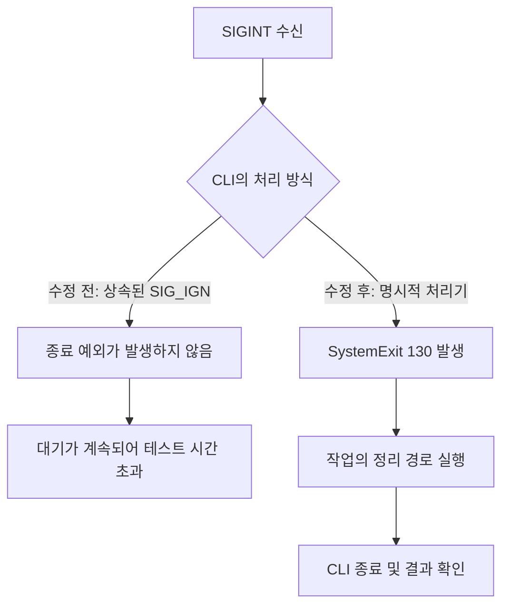

# CI에서 Ctrl-C가 먹히지 않은 이유: SIGINT·SIGTERM과 Python 종료 처리

작성일: 2026-10-29. 사례와 검증 결과는 2026-10-28 실행 기준이다.

프로그램이 중단 요청을 받아도 종료되지 않아 테스트가 시간 초과로 실패하는 일이 있었다. 원인은 실행 환경에서 상속된 **SIGINT 무시 설정**이었다. Python 프로그램이 SIGINT 처리기를 명시적으로 등록하지 않아, 로컬 터미널에서는 작동하던 Ctrl-C 처리가 Linux CI에서 작동하지 않았다.

이 글은 특정 프로젝트의 구조를 몰라도 이해할 수 있도록 신호, 예외, 종료 코드, 자식 프로세스 정리를 순서대로 설명한다. 사례에 등장하는 CI는 코드 변경을 자동으로 검증하는 실행 환경이고, AWS CodeBuild는 그 실행 환경을 제공하는 서비스다. uv는 Python 프로그램을 지정된 실행 환경에서 시작하는 도구이며, pytest는 테스트 실행기다.

## 1. 중단 요청과 실제 종료 사이에는 프로그램의 처리가 있다

운영 도구는 대개 혼자 실행되지 않는다. Python 도구가 Git, 데이터베이스 클라이언트, 클라우드 명령 등을 자식 프로세스로 실행하고 그 결과를 기다린다.

```text
CI의 명령 실행 환경
└─ uv
   └─ Python 운영 도구
      └─ Git·데이터베이스 클라이언트·클라우드 명령
```

이 구조에서 사용자가 작업을 취소하면 다음까지 확인해야 한다.

- Python 도구가 중단 요청을 받았는가?
- 이미 실행한 자식 명령도 멈췄는가?
- 자신이 만든 임시 자원을 정리했는가?
- 성공과 구분되는 종료 결과를 부모 프로세스에 전달했는가?

부모 프로그램이 종료됐다고 자식 명령이나 클라우드의 원격 작업까지 자동으로 종료되는 것은 아니다. 특히 데이터 변경 명령은 이미 실행됐을 수 있으므로, 중단 후 같은 작업을 무조건 다시 실행해서도 안 된다.

## 2. SIGINT와 SIGTERM은 무엇인가

신호(signal)는 운영체제나 다른 프로세스가 실행 중인 프로세스에 사건이나 요청을 알리는 방식이다. 이 글은 Linux를 중심으로 한 유닉스 계열 환경을 다룬다.

| 신호 | 이 사례의 Linux 신호 번호 | 일반적인 용도 | 처리기 등록·무시 가능 여부 |
| --- | ---: | --- | --- |
| SIGINT | 2 | 사용자의 작업 중단. 터미널의 Ctrl-C가 대표적이다. | 가능 |
| SIGTERM | 15 | 다른 프로그램이나 운영 도구가 보내는 종료 요청 | 가능 |
| SIGKILL | 9 | 프로그램의 협조 없이 강제 종료 | 불가능 |

SIGINT와 SIGTERM 자체가 프로그램의 결함을 뜻하지는 않는다. 사용자가 정상적으로 취소했거나 관리 도구가 종료를 요청할 때도 발생한다. 이번 결함은 **중단 요청에 반응하지 않아 작업과 정리가 끝나지 않은 것**이다.

프로세스는 신호별로 기본 동작, 무시, 사용자 정의 처리기 중 하나를 사용할 수 있다. Python에서는 `SIG_DFL`이 운영체제 기본 동작, `SIG_IGN`이 무시 설정을 뜻한다. SIGINT와 SIGTERM의 운영체제 기본 동작은 종료이지만, Python에서 예외를 거쳐 종료하는 방식과는 구분해야 한다. SIGKILL로 종료되면 Python의 정리 코드를 실행할 기회도 없다. [Linux signal 매뉴얼](https://man7.org/linux/man-pages/man7/signal.7.html)

## 3. 신호, Python 예외, 종료 코드는 서로 다른 단계다

세 개념을 연결하면 다음과 같다.

```text
운영체제 신호를 받음
→ 등록된 신호 처리기가 실행됨
→ 처리기가 Python 예외를 발생시킴
→ 예외가 전파되며 정리 코드가 실행됨
→ 프로세스가 종료 코드를 반환함
```

이 경로는 프로그램이 예외를 이용해 종료하도록 구현했을 때의 흐름이다.

### Python의 기본 SIGINT 처리

Python은 보통 SIGINT를 받으면 `KeyboardInterrupt` 예외를 발생시킨다. 다만 부모 프로세스가 설정을 바꾼 경우까지 같은 동작을 보장하지는 않는다. `SIG_IGN` 상태에서는 신호를 받아도 이 기본 예외 처리에 도달하지 않을 수 있다. [Python signal 문서](https://docs.python.org/3.12/library/signal.html)

따라서 다음 코드는 실제로 `KeyboardInterrupt`가 발생했을 때만 동작한다.

```python
try:
    run_job()
except KeyboardInterrupt:
    print("작업이 중단되었습니다.")
```

SIGTERM은 Python이 자동으로 `KeyboardInterrupt`로 바꾸는 신호가 아니다. SIGTERM에서도 정리가 필요하면 프로그램이 그 처리 방식을 정해야 한다.

### SystemExit로 종료하기

`raise SystemExit(130)`과 `sys.exit(130)`은 Python의 예외 처리 경로를 이용해 종료를 요청한다. 이 예외가 최상위까지 전파되면 종료 코드 130으로 끝난다. 전파 중에는 해당 경로의 `finally`와 컨텍스트 관리자의 종료 처리가 실행될 수 있다. [Python sys.exit 문서](https://docs.python.org/3.12/library/sys.html#sys.exit)

```python
try:
    raise SystemExit(130)
finally:
    print("종료 전에 이 경로의 정리 코드를 실행합니다.")
```

`SystemExit`와 `KeyboardInterrupt`는 `Exception`의 하위 클래스가 아닌 `BaseException`의 하위 클래스다. 따라서 일반적인 `except Exception:`으로 잡히지 않는다. 정리 목적으로 `except BaseException:`을 사용한다면, 정리 후 다시 예외를 발생시켜 종료 요청을 유지해야 한다. [Python 예외 계층 문서](https://docs.python.org/3.12/library/exceptions.html#exception-hierarchy)

### 130과 143의 의미

이 사례의 CLI는 신호 처리 후 `128 + 신호 번호`를 종료 코드로 사용했다.

| 처리한 신호 | 계산 | CLI의 종료 코드 |
| --- | --- | ---: |
| SIGINT | 128 + 2 | 130 |
| SIGTERM | 128 + 15 | 143 |

Bash도 명령이 신호 번호 N에 의해 종료된 결과를 `128 + N`으로 표현한다. 여기서는 그 관례와 맞춰 프로그램이 직접 같은 숫자를 반환하도록 했다. [Bash 종료 상태 문서](https://www.gnu.org/software/bash/manual/html_node/Exit-Status.html)

관찰하는 API에 따라 표현은 다를 수 있다. POSIX에서 Python의 `subprocess`는 자식이 신호 N에 의해 직접 종료되면 `returncode`를 `-N`으로 보고한다. 반면 자식이 `SystemExit(130)`으로 종료했다면 130으로 관찰한다. 그러므로 `-2`와 130은 원인과 관찰 경로를 함께 보고 해석해야 한다. [Python subprocess 문서](https://docs.python.org/3.12/library/subprocess.html#subprocess.Popen.returncode)

## 4. 왜 로컬에서는 통과하고 CI에서는 실패했는가

이번에는 서로 다른 운영체제라는 사실보다 **프로그램이 시작할 때 받은 상태**가 중요했다.

Linux에서는 자식 프로세스가 부모의 신호 처리 설정을 상속한다. 다른 실행 파일로 교체하는 `exec` 과정에서 잡아서 처리하던 신호는 기본값으로 바뀌지만, 무시하도록 설정된 신호는 무시 상태가 유지된다. [Linux 신호 상속 설명](https://man7.org/linux/man-pages/man7/signal.7.html)

이번 CodeBuild 진단에서는 시스템 Python과 uv로 시작한 Python이 모두 다음을 출력했다.

```text
SYSTEM_SIGINT <Handlers.SIG_IGN: 1>
UV_PYTHON_SIGINT <Handlers.SIG_IGN: 1>
```

이 로그는 두 Python 프로세스가 SIGINT 무시 상태로 시작했다는 관찰 결과다. uv를 거쳐 실행해도 해당 상태가 초기화되지 않았다. CodeBuild 실행 경로의 어느 상위 프로세스가 최초로 무시 설정을 만들었는지까지 특정한 결과는 아니다. 모든 Linux나 모든 CodeBuild 실행이 항상 같은 상태라는 뜻도 아니다.

로그의 `1`은 무시 설정을 나타내는 `SIG_IGN`의 값이다. SIGINT의 신호 번호인 `2`와는 별개다.

기존 공통 CLI는 SIGTERM 처리기만 등록하고, SIGINT는 Python의 기본 `KeyboardInterrupt`에 맡겼다. 그 결과 다음 순서로 실패했다.

1. 테스트가 운영 CLI와 가짜 자식 명령을 실행한다.
2. 자식 명령이 실행 준비됐음을 확인한 뒤 SIGINT를 보낸다.
3. CLI는 상속된 SIGINT 무시 설정 때문에 종료 예외를 발생시키지 않는다.
4. CLI가 계속 기다리므로 자식 정리와 종료 코드 검증까지 도달하지 못한다.
5. 테스트의 제한 시간이 지나 `TimeoutExpired` 또는 종료 상태 미확인으로 실패한다.

최소 Linux 재현에서도 Git 검증 중단 테스트 하나가 약 10초 뒤 시간 초과로 실패했다. 이를 통해 전체 테스트 규모와 무관하게 같은 결함을 재현할 수 있었다.

## 5. 수정은 두 신호의 처리기를 명시적으로 등록하는 것이었다

실제 구현에서 업무 오류 처리 등을 생략한 핵심 구조는 다음과 같다.

```python
import signal


def run_cli(main):
    def interrupt(signum, _frame):
        raise SystemExit(128 + signum)

    previous = {
        signum: signal.signal(signum, interrupt)
        for signum in (signal.SIGINT, signal.SIGTERM)
    }
    try:
        return main()
    finally:
        for signum, handler in previous.items():
            signal.signal(signum, handler)
```

`signal.signal()`은 처리기를 등록하면서 이전 설정을 반환한다. 이를 보관했다가 복원하면 호출이 끝난 뒤 같은 프로세스의 다른 코드에 설정 변경을 남기지 않는다. Python의 신호 처리기 등록은 주 인터프리터의 메인 스레드에서 해야 한다. [Python signal.signal 문서](https://docs.python.org/3.12/library/signal.html#signal.signal)

수정 후 SIGINT를 받으면 130, SIGTERM을 받으면 143을 가진 `SystemExit`가 발생한다. 이 예외가 작업 코드의 정리 경로를 통과하도록 한 것이다. 신호 처리기 안에 원격 API 호출이나 긴 정리 작업을 모두 넣지는 않았다.



이 정책은 중단 시 정리가 필요한 운영 CLI를 위해 선택한 것이다. 모든 Python 라이브러리가 호출자의 신호 정책을 임의로 바꿔야 한다는 일반 규칙은 아니다.

## 6. 종료 예외를 발생시키는 것과 자원을 정리하는 것은 별도 책임이다

### 로컬 자식 프로세스

Python 부모가 종료해도 외부 명령이 남을 수 있다. 이를 처리하기 위해 일반 명령 실행기는 `start_new_session=True`로 자식의 세션을 분리하고, 취소나 시간 초과 시 해당 프로세스 그룹을 정리했다.

프로세스 그룹은 여러 프로세스에 함께 신호를 보낼 수 있는 단위다. `os.kill(pid, signal)`은 특정 프로세스에, `os.killpg(pgid, signal)`은 그룹에 신호를 보낸다. 그룹은 부모·자식 관계 자체와는 다르며, 자식이 다른 그룹이나 세션으로 빠져나가면 같은 그룹 신호로 정리할 수 없다. [Python os.killpg 문서](https://docs.python.org/3.12/library/os.html#os.killpg)

이 사례의 정리 함수는 그룹에 SIGTERM을 보내고 최대 5초 동안 직접 자식의 종료를 기다린 뒤, 그룹에 남은 프로세스에 SIGKILL을 보냈다. 마지막에는 직접 자식의 종료 상태를 회수했다. 부모 역할의 명령이 먼저 끝나도 그 명령이 만든 다른 프로세스가 남을 수 있기 때문이다.

실행기에서는 대략 다음처럼 종료 예외와 시간 초과를 모두 정리 경로로 연결했다.

```python
try:
    output, errors = process.communicate(timeout=timeout)
except BaseException:
    stop_process_group(process)
    process.communicate()
    raise
```

`start_new_session=True`는 신호 무시 설정을 초기화하는 옵션이 아니다. 자식 실행의 그룹 경계와 취소 범위를 만들기 위한 설정이다. [Python subprocess 프로세스 설정](https://docs.python.org/3.12/library/subprocess.html#subprocess.Popen)

### 원격 임시 작업

클라우드 명령을 실행한 로컬 프로세스를 종료해도, 이미 서버에서 시작한 작업은 계속 실행될 수 있다. 그래서 복구 도구는 자신이 만든 임시 원격 작업의 식별자를 추적하고, 종료 경로에서 중지·정리하는 처리를 별도로 가졌다.

정리 대상은 자신이 생성했고 소유권을 확인한 자원으로 제한했다. 기존 운영 자원이나 다른 실행이 만든 자원을 함께 삭제해서는 안 된다. 응답을 받지 못한 쓰기는 이미 성공했을 가능성이 있으므로, 자동 재실행으로 중복 변경을 만들지 않는 것도 검증 대상이었다.

### 터미널을 사용하는 작업

비밀번호 복구처럼 대화형 입력이 필요한 명령에는 터미널의 전경 프로세스 그룹과 입력 표시 설정도 중요하다. 일반적인 터미널 설정에서 Ctrl-C는 전경 그룹에 SIGINT를 전달한다. Python 부모와 대화형 자식 중 누가 전경 그룹인지에 따라 신호를 받는 대상도 달라진다.

이 사례의 대화형 실행기는 자식 그룹에 터미널 제어권을 넘기고, 종료 후 원래 전경 그룹과 터미널 속성을 복원했다. 비밀번호 입력 중 끈 echo도 복구해야 했다. echo는 입력 문자를 화면에 표시하는 설정이다.

테스트는 가상 터미널인 PTY를 사용해 숨겨진 입력과 Ctrl-C를 실제 터미널 경로로 검증했다. 표준 입출력을 단순히 캡처하는 테스트만으로는 이 동작을 충분히 확인하기 어렵다. [Python PTY 문서](https://docs.python.org/3.12/library/pty.html)

## 7. 실패한 11개 테스트가 모두 신호 문제였던 것은 아니다

실패 빌드는 Python 테스트 491개를 끝까지 실행했고, 480개 통과·11개 실패였다. 그중 SIGINT 때문에 실패한 테스트는 7개였다.

| 신호 관련 테스트 | 개수 | 확인하려던 조건 |
| --- | ---: | --- |
| DB 초기화 중 관리자 SQL·앱 연결 단계 취소 | 2 | 자식 클라이언트 정리, SQL 재실행 방지, 성공 보고 방지 |
| Git 검증 중 취소 | 1 | Git 자식 종료와 CLI 종료 코드 130 |
| 유지보수 설정 쓰기 중 취소 | 1 | 쓰기 명령 종료와 자동 재시도 방지 |
| 비밀번호 복구·DB 복구 검증 중 취소 | 2 | 로컬 프로세스와 자신이 만든 원격 임시 작업 정리 |
| PTY에서 입력 중 Ctrl-C | 1 | 숨겨진 입력 유지, 터미널 복원, 임시 작업 정리 |

이 7개는 가짜 외부 명령과 로컬 프로세스로 실패 상황을 재현했다. 실제 운영 DB나 AWS 자원을 변경하는 테스트가 아니었다. SIGTERM의 처리도 같은 테스트군에서 검증했지만, 이 빌드에서 확인된 신호 관련 실패는 SIGINT 사례였다.

나머지 4개는 **테스트 환경변수 격리 누락**이었다. CI가 제공한 `AWS_CONTAINER_CREDENTIALS_RELATIVE_URI`가 테스트 프로세스에 남아 있어, 예상한 복구·정리 동작에 도달하기 전에 자격증명 검사에서 차단됐다.

테스트용 환경 사전을 만들 때 이 변수를 제외했더라도, 같은 프로세스에서 환경변수를 추가하기만 하면 이미 존재하던 변수는 사라지지 않는다. 따라서 제외한 기존 변수는 `monkeypatch.delenv()`로 명시적으로 지우도록 수정했다. 실제 운영 도구의 자격증명 검사는 유지했다.

신호 설정과 환경변수는 서로 다른 문제지만, 둘 다 “실행 환경에서 상속한 상태”를 테스트가 충분히 통제하지 못했다는 공통점이 있었다.

## 8. 수정이 효과가 있었는지는 어떻게 확인했는가

검증은 작은 재현에서 시작해 실제 CI로 넓혔다.

| 검증 | 확인한 내용 | 당시 결과 |
| --- | --- | --- |
| 수정 전 최소 Linux 재현 | SIGINT 설정을 출력하고 중단 테스트 한 개 실행 | Python·uv 경로 모두 SIG_IGN, 테스트 시간 초과 |
| 신호 처리 회귀 테스트 | 미리 SIG_IGN으로 설정해도 CLI가 신호를 처리하고 기존 설정을 복원하는지 | 통과 |
| 로컬 관련 테스트 | 가짜 CI 자격증명 환경에서 환경 격리·복구 호출부·진단 검증 | 26개 통과 |
| 수정 후 최소 Linux 검증 | SIGINT 무시 상태를 상속한 환경에서 기존 실패와 대응 SIGTERM·PTY 검증 | 38개 통과 |
| 전체 인프라 CI | 다른 테스트와 실제 bootstrap 이미지 검증까지 포함 | Python 494개 통과, 실패·건너뜀 0개 |

수정 전후 테스트 수가 491개에서 494개로 늘어난 것은 신호 처리 회귀 사례 2개와 실패 보고서 진단 사례 1개를 추가했기 때문이다.

최종 전체 CI는 약 7분 38초, Python 보고서에 기록된 테스트 시간 합계는 약 5분 27초였다. 이 숫자는 당시 실행의 관찰값이다. 캐시나 실행 환경이 다른 후속 실행의 시간을 보장하지 않는다.

실패 빌드가 약 9분 걸렸다는 사실은 “첫 실패를 발견하고 즉시 중단했다”는 뜻이 아니다. 당시 pytest에는 첫 실패 시 중단하는 옵션이 없어서, 실패를 기록하고 나머지 Python 테스트도 실행했다. CI의 단계 사이에서는 실패하면 뒤의 단계로 진행하지 않았다.

첫 SIGINT 실패는 491개 중 58번째 테스트였다. 앞선 57개를 완료한 개수 비율은 약 11.6%이지만, 테스트마다 시간이 다르므로 실행 시간의 11.6%와 같지 않다. 이를 이용해 전체 시간을 `9분 ÷ 11.6%`로 추정할 수 없다.

### 실패 상세를 남기는 방법도 보완했다

처음에는 CI 로그에 테스트 출력의 마지막 60줄만 보여 앞쪽 실패의 상세가 잘렸다. 테스트 결과를 담은 JUnit XML 보고서는 저장돼 있었으므로, 그 보고서에서 실패별 상세를 읽어 CI 로그에 추가로 출력하도록 했다. JUnit XML은 테스트 이름·결과·오류 내용을 기계가 읽을 수 있게 기록하는 형식이다.

출력에는 실패·오류 최대 50건과 약 128,000자 예산을 두었다. 구현의 제한 단위는 바이트가 아닌 Python 문자열 길이다. 원본 JUnit 보고서는 별도로 유지한다. 진단 출력이 늘어나도 원래 테스트 실패를 성공으로 바꾸지는 않는다.

또한 이 CI는 실행 도구를 클라우드 설정 안에 압축해 내장하는 구조였다. 저장소의 코드 수정과 푸시만으로 기존 내장 사본이 바뀌지 않아, 설정 갱신 후 실제 클라우드 설정을 다시 읽어 코드가 반영됐는지 확인했다.

## 9. 이 방식으로도 보장할 수 없는 경계

`SystemExit`는 등록된 처리기와 정리 경로를 연결하는 수단이다. 자동으로 모든 자원을 정리하거나 데이터 변경을 되돌리는 기능은 없다. 이미 작성한 `finally`, 컨텍스트 관리자, 자식 종료, 원격 정리 코드가 있어야 한다.

SIGKILL, 프로세스가 실행되는 장비의 종료, 정리 도중의 추가 중단 등에서는 정리가 끝나지 않을 수 있다. 원격 자원에는 소유권 추적과 별도의 잔여 자원 확인 방법도 필요하다.

Python의 신호 처리기는 메인 스레드에서 실행되며, 오래 실행되는 C 코드 등으로 처리가 늦어질 수 있다. 신호를 보내는 즉시 모든 실행이 멈춘다고 가정해서는 안 된다. [Python 신호 처리 시점](https://docs.python.org/3.12/library/signal.html#execution-of-python-signal-handlers)

타임아웃은 기다림의 상한이며 무시된 신호의 원인을 고치지는 않는다. 실패가 반복될 때는 제한 시간을 늘리기 전에, 신호를 받을 프로세스·그룹과 시작 시의 처리 설정을 확인해야 한다.

## 부록: 사례의 코드와 검증 이력

일반 개념을 이해하는 데 아래 프로젝트의 사전 지식은 필요하지 않다. 구현과 관찰 결과를 확인하려는 독자를 위한 연결이다.

| 역할 | 저장소 경로 |
| --- | --- |
| SIGINT·SIGTERM 처리기 등록과 복원 | `infra/scripts/lib/cli.py`의 `run_cli()` |
| 자식 프로세스 그룹 종료와 터미널 복원 | `infra/scripts/lib/processes.py` |
| 상속된 무시 설정과 신호 중단 회귀 테스트 | `infra/scripts/tests/test_processes.py` |
| DB 초기화 중 취소 테스트 | `infra/scripts/tests/test_database_bootstrap.py` |
| 원격 임시 작업·PTY 복구 테스트 | `infra/scripts/tests/test_recovery_operations.py` |
| 유지보수 쓰기 중 취소 테스트 | `infra/scripts/tests/test_production_maintenance.py` |
| JUnit 실패별 진단과 전체 검증 연결 | `infra/scripts/lib/diagnostics.py`, `infra/scripts/verify_infrastructure.py` |

2026-10-28 진단 당시 Python은 3.12.13, uv는 0.12.22였으며, Linux ARM64 CodeBuild에서 재현했다. 이후 도구 버전이나 구현은 달라질 수 있다.

- [관련 변경과 검증을 포함한 PR #417](https://github.com/icar-mobility/icar-erp/pull/417)
- [병합된 공통 CLI 구현](https://github.com/icar-mobility/icar-erp/blob/86cf42a301cad85ea9a6ec867d6f27c9687b0b00/infra/scripts/lib/cli.py)
- [병합된 프로세스 관리 구현](https://github.com/icar-mobility/icar-erp/blob/86cf42a301cad85ea9a6ec867d6f27c9687b0b00/infra/scripts/lib/processes.py)
- [실패 빌드 efdc2761](https://ap-northeast-2.console.aws.amazon.com/codebuild/home?region=ap-northeast-2#/builds/icar-erp-production-infrastructure-verify:efdc2761-cb63-46ac-bbcb-11fd38719123/view/new)
- [최종 성공 빌드 522cd928](https://ap-northeast-2.console.aws.amazon.com/codebuild/home?region=ap-northeast-2#/builds/icar-erp-production-infrastructure-verify:522cd928-5360-4246-a886-e8d1dca5ec90/view/new)

사례의 저장소·AWS 실행 기록은 접근 권한이 필요하고 서비스의 보존 기간에 따라 조회가 제한될 수 있다. 본문의 개념 설명과 공식 문서 링크는 이 실행 기록 없이도 읽을 수 있다.
