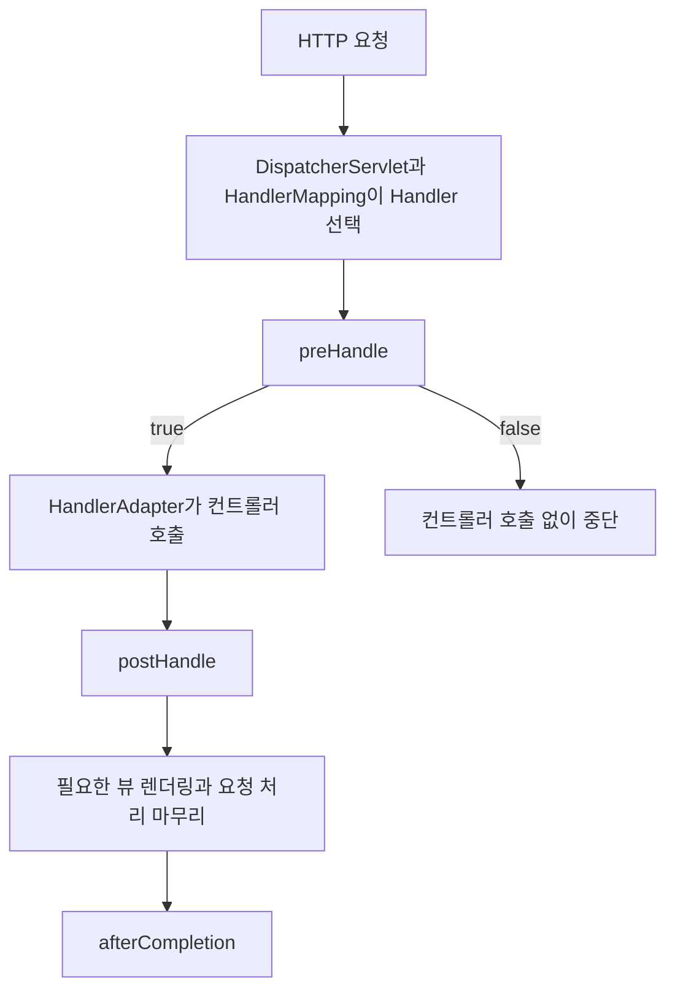

# Spring MVC의 HandlerInterceptor 이해하기

HandlerInterceptor는 **웹 요청의 처리 전후에 공통 코드를 실행하도록 Spring MVC가 제공하는 인터페이스**다. 컨트롤러마다 반복되는 로깅, 처리 시간 측정, 요청 문맥 준비 등을 한곳에 모을 때 사용한다. 특정 프로젝트의 구조를 몰라도 이해할 수 있도록 일반적인 HTTP API를 예로 설명한다.

## 먼저 알아둘 용어

| 용어 | 의미 |
|---|---|
| HTTP 요청·응답 | 클라이언트가 서버에 보내는 요청과 서버가 돌려주는 결과 |
| 컨트롤러 | URL에 대응해 요청을 처리하는 애플리케이션 코드 |
| DispatcherServlet | Spring MVC의 요청 처리를 조율하는 중심 구성 요소 |
| Handler | 선택된 요청 처리 대상. 보통 컨트롤러 메서드이며 다른 종류도 있다 |
| 콜백 | 정해진 시점에 프레임워크가 호출하도록 제공하는 메서드 |
| Interceptor | 처리 흐름의 중간에 참여해 공통 동작을 수행하는 구성 요소 |

예를 들어 주문 조회와 상품 조회에 처리 시간을 기록한다고 하자. 두 컨트롤러에 측정 코드를 복사하는 대신, 인터셉터 하나를 두 경로에 등록할 수 있다. HandlerInterceptor의 목적과 처리 위치는 [공식 API 문서](https://docs.spring.io/spring-framework/docs/current/javadoc-api/org/springframework/web/servlet/HandlerInterceptor.html)에 정의되어 있다.

## 요청 흐름에서의 위치

일반적인 동기 요청은 다음 순서로 진행된다. 오류·비동기 처리는 뒤에서 구분한다.



preHandle은 처리 대상이 선택된 뒤 실행된다. 따라서 HTTP 요청이 서버에 도착하자마자 실행되는 가장 바깥 단계는 아니다. [공식 API 문서](https://docs.spring.io/spring-framework/docs/current/javadoc-api/org/springframework/web/servlet/HandlerInterceptor.html)

## 세 가지 콜백

| 메서드 | 호출 시점 | 주요 용도 |
|---|---|---|
| preHandle | Handler 실행 전 | 공통 조건 검사, 시작 정보 준비 |
| postHandle | Handler의 정상 실행 후 | 뷰에 전달할 모델 보완 |
| afterCompletion | 요청 처리 마무리 후 | 자원 정리, 완료 기록 |

preHandle의 반환값이 true면 다음 인터셉터나 Handler로 진행한다. false면 뒤쪽 실행을 중단한다. **false 자체가 오류 응답을 만들어 주지는 않는다.** 중단할 때는 응답을 작성하는 등의 처리가 필요하다. [공식 API 문서](https://docs.spring.io/spring-framework/docs/current/javadoc-api/org/springframework/web/servlet/HandlerInterceptor.html)

나머지 두 메서드는 반환값으로 진행 여부를 결정하지 않는다. 기본 구현은 비어 있으므로 필요한 콜백만 재정의할 수 있다.

## Kotlin 예제: 처리 시간 기록

다음 예제는 일반적인 동기 요청의 처리 시간을 기록한다. 본문이나 인증 정보를 로그에 넣지 않는다.

```kotlin
import jakarta.servlet.http.HttpServletRequest
import jakarta.servlet.http.HttpServletResponse
import org.slf4j.LoggerFactory
import org.springframework.web.servlet.HandlerInterceptor

class RequestTimingInterceptor : HandlerInterceptor {
    private val logger = LoggerFactory.getLogger(javaClass)
    private val startedAtKey = "example.request.startedAtNanos"

    override fun preHandle(
        request: HttpServletRequest,
        response: HttpServletResponse,
        handler: Any,
    ): Boolean {
        request.setAttribute(startedAtKey, System.nanoTime())
        return true
    }

    override fun afterCompletion(
        request: HttpServletRequest,
        response: HttpServletResponse,
        handler: Any,
        ex: Exception?,
    ) {
        val startedAt = request.getAttribute(startedAtKey) as? Long ?: return
        val elapsedMillis = (System.nanoTime() - startedAt) / 1_000_000
        logger.info(
            "Request completed: status={}, elapsedMs={}",
            response.status,
            elapsedMillis,
        )
    }
}
```

시작 시각은 인터셉터의 변경 가능한 필드 대신 request 속성에 저장했다. 하나의 인터셉터 인스턴스를 여러 요청이 함께 사용할 수 있으므로, 요청마다 달라지는 값을 인스턴스 필드에 저장하면 서로 덮어쓸 수 있기 때문이다. 위의 startedAtKey는 모든 요청이 공유하는 속성 이름이고 실제 측정값은 각 request에 들어간다.

## 등록해야 적용된다

클래스를 구현하거나 빈으로 만드는 것만으로 모든 MVC 요청에 자동 적용되는 것은 아니다. 일반적인 MVC Java 설정에서는 WebMvcConfigurer로 등록하고 경로를 지정한다. [인터셉터 설정 공식 문서](https://docs.spring.io/spring-framework/reference/web/webmvc/mvc-config/interceptors.html)

```kotlin
import org.springframework.context.annotation.Configuration
import org.springframework.web.servlet.config.annotation.InterceptorRegistry
import org.springframework.web.servlet.config.annotation.WebMvcConfigurer

@Configuration
class WebConfiguration : WebMvcConfigurer {
    override fun addInterceptors(registry: InterceptorRegistry) {
        registry.addInterceptor(RequestTimingInterceptor())
            .addPathPatterns("/api/**")
            .excludePathPatterns("/api/health")
    }
}
```

이 예제는 `/api/**`에 적용하고 `/api/health`는 제외한다. Spring Boot에서 일반적인 MVC 자동 설정을 확장하는 예제이며 별도의 `@EnableWebMvc`는 추가하지 않았다.

## 오류와 응답 작성 시점

Handler가 예외를 던지면 postHandle은 호출되지 않을 수 있다. afterCompletion은 해당 인터셉터의 preHandle이 정상적으로 true를 반환한 경우에 실행된다. 자신이 false를 반환한 경우의 정리를 afterCompletion에 맡기면 안 된다. [공식 API 문서](https://docs.spring.io/spring-framework/docs/current/javadoc-api/org/springframework/web/servlet/HandlerInterceptor.html)

REST API의 `@ResponseBody`나 ResponseEntity는 postHandle 전에 응답이 이미 작성·커밋될 수 있다. 따라서 모든 응답에 헤더를 추가하려면 preHandle을, 응답 본문 변환에 참여하려면 ResponseBodyAdvice 등을 검토한다. [요청 가로채기 공식 문서](https://docs.spring.io/spring-framework/reference/web/webmvc/mvc-servlet/handlermapping-interceptor.html)

여러 인터셉터가 있으면 앞쪽 처리는 등록 순서로, 후처리는 역순으로 실행된다. 비동기 요청은 재디스패치 때문에 콜백 흐름이 달라질 수 있으므로 위 측정 예제를 그대로 일반화하지 않고 AsyncHandlerInterceptor 계약도 확인해야 한다. [공식 API 문서](https://docs.spring.io/spring-framework/docs/current/javadoc-api/org/springframework/web/servlet/HandlerInterceptor.html)

## Servlet Filter와의 차이

| 구분 | Servlet Filter | HandlerInterceptor |
|---|---|---|
| 위치 | Servlet을 감싸는 요청 처리 체인 | Spring MVC의 Handler 실행 체인 |
| 처리 대상 선택 | MVC의 Handler 선택보다 앞에서 동작 가능 | Handler가 선택된 뒤 동작 |
| 대표 용도 | 광범위한 요청·응답 처리, 보안 체인 | Handler에 관련된 공통 전후 처리 |
| 요청·응답 객체 교체 | 래퍼를 다음 단계에 전달 가능 | 콜백의 요청·응답을 직접 교체하는 계약은 없음 |

Spring은 인증·인가의 주된 보안 경계에는 Spring Security 또는 Servlet Filter 체계처럼 더 앞에서 적용되는 구성을 권장한다. 컨트롤러와 인터셉터의 경로 매칭이 어긋날 가능성도 고려해야 하기 때문이다. [요청 가로채기 공식 문서](https://docs.spring.io/spring-framework/reference/web/webmvc/mvc-servlet/handlermapping-interceptor.html)

HandlerInterceptor는 컨트롤러에 공통 처리를 반복하지 않게 해 주지만, 적용 경로·콜백 시점·응답 작성 시점을 함께 이해하고 사용하는 구성 요소다.
