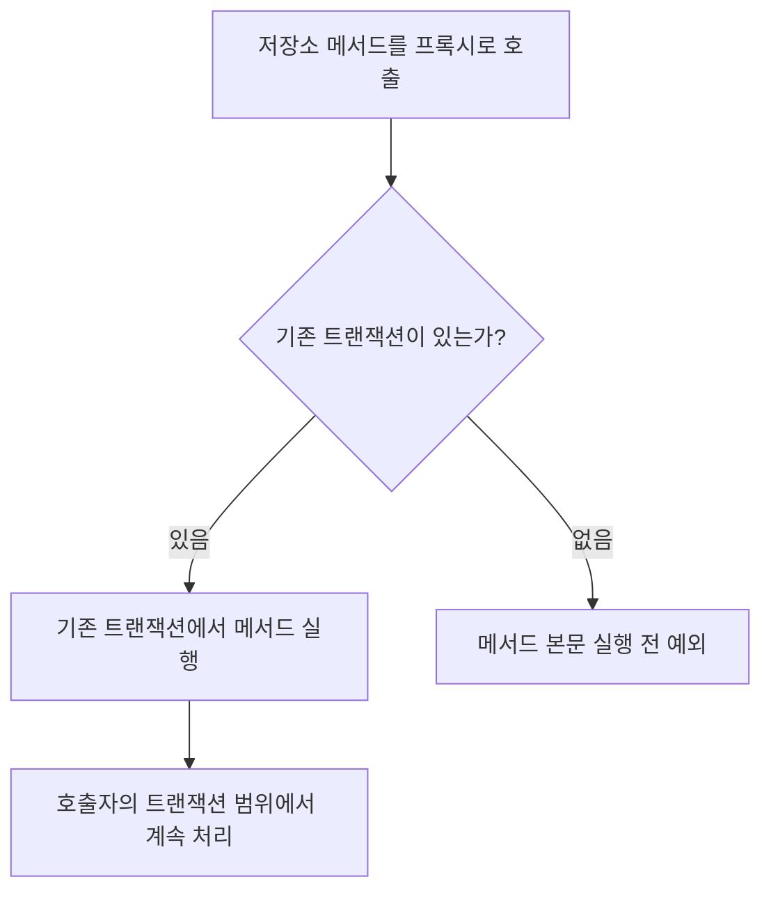

# Spring의 `MANDATORY`: 호출자가 시작한 트랜잭션을 요구하는 방법

`@Transactional(propagation = Propagation.MANDATORY)`는 **기존 트랜잭션이 있을 때만 메서드를 실행하도록 하는 선언**이다.
트랜잭션이 있으면 참여하고, 없으면 예외를 발생시킨다. 스스로 새 트랜잭션을 시작하지 않는다.
[Spring Propagation API](https://docs.spring.io/spring-framework/docs/current/javadoc-api/org/springframework/transaction/annotation/Propagation.html#MANDATORY)

이 글은 Kotlin의 클래스와 함수를 읽을 수 있는 독자를 대상으로 한다. 특정 프로젝트에 대한 지식은 필요하지 않다.
계정과 문자 발신번호를 함께 관리하는 예제로 트랜잭션의 범위, 전파 방식, 저장소의 호출 전제를 설명한다.
범위는 Spring의 `PlatformTransactionManager`를 사용하는 일반적인 JDBC·MyBatis 애플리케이션이다.
리액티브 트랜잭션의 컨텍스트 전파는 별도 주제다.

## 1. 트랜잭션은 어떤 작업을 하나로 묶는가

트랜잭션은 여러 DB 작업을 함께 확정하거나 취소하기 위한 실행 단위다.
변경을 확정하는 것을 커밋, 확정하지 않고 되돌리는 것을 롤백이라고 한다.
예를 들어 계정의 표시 이름과 그 계정의 문자 발신번호를 함께 바꿀 때,
발신번호 중복으로 실패했다면 표시 이름만 바뀐 상태가 남지 않도록 묶을 수 있다.

여기서 두 역할을 구분하면 설계를 이해하기 쉽다.

| 구성 요소 | 책임 |
| --- | --- |
| 서비스 | 하나의 업무를 구성하고, 함께 성공·실패할 DB 작업의 범위를 정한다 |
| 저장소 | 조회·삽입·수정·삭제 SQL을 실행한다 |
| 트랜잭션 관리자 | 트랜잭션을 시작하거나 기존 트랜잭션에 참여하고, 완료 시 커밋·롤백을 처리한다 |

Spring에서는 서비스 메서드에 `@Transactional`을 붙여 업무 범위를 표현할 수 있다.
애노테이션의 메타데이터를 실제로 적용하려면 Spring의 트랜잭션 관리 설정과 관리 대상 빈이 필요하다.
[Spring의 @Transactional 사용법](https://docs.spring.io/spring-framework/reference/data-access/transaction/declarative/annotations.html)

## 2. 전파 속성은 호출 사이의 트랜잭션 관계를 정한다

서비스가 저장소를 호출할 때 양쪽에 트랜잭션 선언이 있을 수 있다.
전파 속성은 이때 기존 트랜잭션에 참여할지, 새로 만들지, 호출을 거부할지를 정한다.

| 전파 속성 | 기존 트랜잭션이 있을 때 | 기존 트랜잭션이 없을 때 |
| --- | --- | --- |
| `REQUIRED` | 기존 트랜잭션에 참여 | 새 트랜잭션 시작 |
| `MANDATORY` | 기존 트랜잭션에 참여 | 예외 발생 |
| `REQUIRES_NEW` | 기존 트랜잭션을 일시 중단하고 독립 트랜잭션 시작 | 새 트랜잭션 시작 |
| `SUPPORTS` | 기존 트랜잭션에 참여 | 트랜잭션 없이 실행 가능 |

별도 설정이 없는 `@Transactional`의 전파 속성은 `REQUIRED`다.
서비스와 저장소에 각각 기본 애노테이션이 있어도, 같은 트랜잭션 관리 환경에서 호출되면
보통 하나의 물리 트랜잭션을 공유한다. 선언 개수만큼 독립적인 DB 트랜잭션이 생기는 것은 아니다.
[전파 속성 정의](https://docs.spring.io/spring-framework/docs/current/javadoc-api/org/springframework/transaction/annotation/Propagation.html),
[물리·논리 트랜잭션과 REQUIRED](https://docs.spring.io/spring-framework/reference/data-access/transaction/declarative/tx-propagation.html)

`MANDATORY`를 선택하는 이유는 이미 트랜잭션이 있는 정상 경로의 실행 방식을 바꾸려는 데 있지 않다.
**트랜잭션이 없는 잘못된 호출을 허용하지 않겠다는 전제**를 코드로 표현하는 데 있다.

## 3. 저장소마다 트랜잭션을 만들어도 업무 전체가 보호되지는 않는다

관리자가 화면에 표시된 발신번호의 등록 완료를 확인한다고 가정하자.
확인 중 다른 관리자가 번호를 변경하면 이전 번호의 등록 결과가 새 번호에 적용되지 않도록 해야 한다.
이를 위해 업무 전체를 다음 순서로 처리할 수 있다.

```text
하나의 트랜잭션 T1
  1. 계정 행 잠금
  2. 해당 계정의 발신 설정 행 잠금
  3. 화면에서 확인한 번호와 현재 번호 비교
  4. 등록 상태 변경
  5. T1 커밋, 잠금 해제
```

잠금 조회는 다른 트랜잭션이 같은 데이터를 동시에 변경하는 일을 조율하기 위한 조회다.
MySQL InnoDB에서는 `SELECT ... FOR UPDATE`를 사용할 수 있으며,
이 잠금은 트랜잭션이 커밋되거나 롤백될 때 해제된다.
[MySQL InnoDB의 잠금 조회](https://dev.mysql.com/doc/refman/8.4/en/innodb-locking-reads.html)

서비스에 트랜잭션이 없고 각 저장소 메서드에만 `REQUIRED`가 있으면 범위가 잘게 나뉠 수 있다.

```text
서비스: 트랜잭션 없음
  계정 잠금 조회       → T1 시작·종료, 잠금 해제
  발신 설정 잠금 조회  → T2 시작·종료, 잠금 해제
  번호 비교           → 앞에서 읽은 값으로 검사
  등록 상태 변경      → T3 시작·종료
```

각 조회가 반환된 뒤에는 잠금이 이미 해제되어 다른 변경이 끼어들 수 있다.
필요한 범위는 SQL 한 번이 아니라 조회·검증·변경을 포함한 업무 전체다.

이때 저장소에 `MANDATORY`를 적용하면 서비스의 트랜잭션 누락을 즉시 발견할 수 있다.
기본 Spring 트랜잭션 관리자에서는 `IllegalTransactionStateException`으로 호출이 거부된다.



애노테이션을 제거하는 것과도 다르다. Spring 트랜잭션 없이 MyBatis-Spring 매퍼의 쓰기를 호출하면
작업이 자동 커밋될 수 있다. `MANDATORY`는 그러한 호출이 저장 코드에 진입하기 전에 실패하도록 한다.
[MyBatis-Spring 트랜잭션 동작](https://mybatis.org/spring/transactions.html)

## 4. 서비스는 범위를 만들고 저장소는 그 범위를 요구한다

다음은 구조를 보여 주는 축약 예제다. SQL 매퍼 등록·매핑과 계정 저장소 구현, DB 설정은 생략했다.
`AccountStore.lockById()`는 계정이 없으면 실패하고, 있으면 해당 행을 잠그는 메서드라고 가정한다.
발신 설정의 `accountId`는 유일하며, 같은 계정을 변경하는 모든 경로가 계정을 먼저 잠그는 정책을 따른다.

```kotlin
import org.springframework.stereotype.Repository
import org.springframework.stereotype.Service
import org.springframework.transaction.annotation.Propagation
import org.springframework.transaction.annotation.Transactional

data class Sender(val accountId: Long, val phoneNumber: String)

class SenderNotFoundException : RuntimeException()
class SenderPhoneChangedException : RuntimeException()
class SenderRegistrationConflictException : RuntimeException()

interface AccountStore {
    fun lockById(accountId: Long)
}

interface SenderStore {
    fun findForUpdate(accountId: Long): Sender?
    fun confirmRegistration(accountId: Long, expectedPhone: String): Boolean
}

interface SenderMapper {
    fun findForUpdate(accountId: Long): Sender?
    fun confirmRegistration(accountId: Long, expectedPhone: String): Int
}

@Repository
class DatabaseSenderStore(private val mapper: SenderMapper) : SenderStore {
    @Transactional(propagation = Propagation.MANDATORY)
    override fun findForUpdate(accountId: Long): Sender? =
        mapper.findForUpdate(accountId)

    @Transactional(propagation = Propagation.MANDATORY)
    override fun confirmRegistration(accountId: Long, expectedPhone: String): Boolean =
        mapper.confirmRegistration(accountId, expectedPhone) == 1
}

@Service
class ConfirmSenderRegistration(
    private val accounts: AccountStore,
    private val senders: SenderStore,
) {
    @Transactional
    fun confirm(accountId: Long, expectedPhone: String) {
        accounts.lockById(accountId)
        val current = senders.findForUpdate(accountId)
            ?: throw SenderNotFoundException()
        if (current.phoneNumber != expectedPhone) {
            throw SenderPhoneChangedException()
        }
        if (!senders.confirmRegistration(accountId, expectedPhone)) {
            throw SenderRegistrationConflictException()
        }
    }
}
```

등록 확인 SQL의 예시는 다음과 같다.

```sql
UPDATE message_senders
SET sender_registration_status = 'REGISTERED'
WHERE app_user_id = :accountId
  AND sender_phone_number = :expectedPhone
  AND sender_registration_status = 'PENDING';
```

`:accountId`와 `:expectedPhone`은 설명용 매개변수 표기다. 실제 문법은 사용하는 SQL 매퍼에 맞춘다.
예상 번호와 상태를 갱신 조건에도 포함하므로 갱신 건수 0을 충돌로 처리할 수 있다.

서비스의 `@Transactional`도 더 바깥의 기존 트랜잭션에 참여할 수 있다.
그 경우 최종 커밋은 이 서비스 메서드가 반환된 뒤, 바깥 트랜잭션이 끝날 때 발생한다.
저장소의 `MANDATORY`는 호출자가 만든 범위에 참여하며 독립된 트랜잭션으로 나누지 않는다.

## 5. 적용할 메서드를 선택한다

모든 저장소 메서드에 일괄 적용할 필요는 없다.

| 메서드의 용도 | 선택 기준 |
| --- | --- |
| 다른 변경과 함께 확정해야 하는 쓰기 | `MANDATORY`로 호출자의 트랜잭션을 요구한다 |
| 검증·수정까지 잠금을 유지해야 하는 조회 | `MANDATORY`로 짧은 단독 트랜잭션에서 실행되는 것을 방지한다 |
| 단독으로 사용할 수 있는 일반 조회 | 요구사항에 맞게 읽기 전용 트랜잭션 등을 선택한다 |
| 독립적으로 호출해도 되고 내부의 여러 SQL만 묶으면 되는 작업 | 저장소의 `REQUIRED`도 선택할 수 있다 |
| 바깥 업무와 독립적으로 확정해야 하는 작업 | 실패 시 의미를 검토한 뒤 `REQUIRES_NEW`를 선택한다 |

`REQUIRES_NEW`는 바깥 트랜잭션과 독립적으로 커밋·롤백한다.
트랜잭션이 없어서 MANDATORY 호출이 실패한다는 이유로 이 속성으로 바꾸면 원래 의도한 원자성이 깨질 수 있다.
먼저 업무의 트랜잭션 경계가 올바른지 확인한다.

## 6. MANDATORY가 보장하는 것과 별도로 보장할 것

`MANDATORY`가 확인하는 것은 **선택한 트랜잭션 관리 환경에서 기존 트랜잭션이 존재한다는 조건**이다.
다음 조건까지 자동으로 확인하지는 않는다.

- 올바른 계정 행을 먼저 잠갔는가
- 모든 변경 경로가 동일한 잠금 순서를 따르는가
- 적절한 격리 수준·DB 제약·갱신 조건을 사용하는가
- 읽기 전용이 아닌 트랜잭션인가
- 여러 DB나 외부 API 변경을 함께 롤백할 수 있는가

계정 행은 항상 존재하고 발신 설정은 선택적으로 존재한다면, 계정을 먼저 잠그는 방식을 사용할 수 있다.
발신 설정 행이 아직 없어도 같은 계정의 설정 생성·제거·재생성을 계정 단위로 직렬화할 수 있다.
이 순서는 서비스에서 보장하며 `MANDATORY` 자체로 검사할 수 없다.

기존 트랜잭션에 참여할 때 내부 메서드의 설정이 바깥 설정을 덮어쓰는 것은 아니다.
쓰기 서비스에서 적절한 트랜잭션을 시작하고, 필요하다면 관리자의 `validateExistingTransaction` 설정으로
지원되는 속성 불일치 검증을 강화할 수 있다.
또한 `readOnly = true`는 일반적으로 최적화 힌트이며 모든 환경에서 쓰기를 금지한다는 보장은 아니다.
[참여 시 속성 처리](https://docs.spring.io/spring-framework/reference/data-access/transaction/declarative/tx-propagation.html),
[Transactional API의 readOnly 설명](https://docs.spring.io/spring-framework/docs/current/javadoc-api/org/springframework/transaction/annotation/Transactional.html#readOnly())

## 7. 애노테이션이 실제로 적용되는 조건

### Spring이 관리하는 프록시를 통해 호출한다

프록시는 실제 객체의 메서드 호출 전후에 트랜잭션 같은 처리를 덧붙이는 객체다.
Spring의 기본 프록시 방식에서는 외부에서 프록시를 거쳐 들어오는 호출에 트랜잭션 처리가 적용된다.
`DatabaseSenderStore(mapper)`처럼 직접 생성한 객체에는 같은 실행 시점 처리가 없다.
테스트에서도 실제 Spring 빈을 주입해야 한다.

같은 클래스 안에서 `this.findForUpdate()`를 호출하면 내부 메서드의 애노테이션은 다시 적용되지 않는다.
예를 들어 외부 진입점인 쓰기 메서드에도 `MANDATORY`를 붙여 진입 시 전제를 검사할 수 있다.
Kotlin에서 클래스 기반 프록시를 사용한다면 `kotlin("plugin.spring")` 등으로 프록시 가능한 클래스를 구성해야 한다.
[프록시와 내부 호출](https://docs.spring.io/spring-framework/reference/data-access/transaction/declarative/annotations.html),
[Kotlin의 Spring 플러그인](https://kotlinlang.org/docs/all-open-plugin.html#spring-support)

### 클래스와 메서드의 선언을 구분한다

클래스에 `@Transactional(readOnly = true)`, 쓰기 메서드에
`@Transactional(propagation = Propagation.MANDATORY)`를 붙이면 메서드 선언이 우선한다.
메서드 선언에서 생략한 `readOnly`는 기본값 false를 사용하지만, 이미 존재하는 바깥 트랜잭션을
읽기·쓰기 트랜잭션으로 전환한다는 뜻은 아니다.
메서드 선언을 제거하면 클래스의 `REQUIRED`가 적용되어 트랜잭션 없는 호출을 다시 허용할 수 있다.
[선언 위치와 우선순위](https://docs.spring.io/spring-framework/reference/data-access/transaction/declarative/annotations.html)

### 새 스레드와 다른 DB에 자동으로 이어지지는 않는다

일반적인 JDBC 트랜잭션은 실행 스레드에 연결된다.
`@Async`나 직접 만든 새 스레드에 바깥 트랜잭션이 그대로 전달된다고 가정하지 않는다.
트랜잭션 관리자가 여러 개라면 저장소의 데이터소스를 관리하는 것을 명확히 선택한다.
MyBatis-Spring에서도 트랜잭션 관리자와 `SqlSessionFactory`에 동일한 데이터소스를 사용해야 한다.
[Transactional API](https://docs.spring.io/spring-framework/docs/current/javadoc-api/org/springframework/transaction/annotation/Transactional.html),
[MyBatis-Spring의 설정](https://mybatis.org/spring/transactions.html)

## 8. 예외와 롤백을 해석하는 방법

`MANDATORY`는 업무 입력 검증이나 API 권한 검사가 아니다.
트랜잭션 없는 호출이 실패하면 보통 호출 경로의 구현이나 설정을 점검해야 한다.
사용자가 입력값을 고쳐 해결할 오류로 처리할 필요는 없다.

또한 메서드가 실패하면 모든 변경이 반드시 돌아간다고 가정하지 않는다.
별도 설정이 없는 Spring의 기본 롤백 규칙은 `RuntimeException`과 `Error`를 대상으로 하며,
checked exception은 관련 설정을 확인해야 한다.
예외를 잡고 정상 반환한다면 어떤 상태가 커밋되는지도 따로 검토한다.
내부 트랜잭션 처리가 rollback-only를 표시한 뒤 바깥에서 커밋하려 하면 `UnexpectedRollbackException`이 발생할 수도 있다.
[롤백 규칙](https://docs.spring.io/spring-framework/docs/current/javadoc-api/org/springframework/transaction/annotation/Transactional.html),
[공유 트랜잭션의 rollback-only](https://docs.spring.io/spring-framework/reference/data-access/transaction/declarative/tx-propagation.html)

이미 발송한 문자나 외부 API의 부수 효과는 DB 롤백만으로 취소되지 않는다.
이 글의 등록 확인 예제는 DB 상태 변경을 뜻하며 외부 제공자의 작업까지 원자적으로 취소한다는 의미는 아니다.

## 9. 선언의 존재보다 실제 호출 결과를 테스트한다

중요한 것은 Spring을 통한 호출이 실제로 거부되는지다.
다음은 테스트 DB와 실제 저장소 빈이 구성된 환경에서 사용하는 테스트 예시다.
테스트 클래스나 메서드에 `@Transactional`을 붙이지 않는다.

```kotlin
import org.assertj.core.api.Assertions.assertThatThrownBy
import org.junit.jupiter.api.Test
import org.springframework.beans.factory.annotation.Autowired
import org.springframework.boot.test.context.SpringBootTest
import org.springframework.transaction.IllegalTransactionStateException

@SpringBootTest
class SenderTransactionIT {
    @Autowired
    private lateinit var senders: SenderStore

    @Test
    fun `locking read requires an existing transaction`() {
        assertThatThrownBy { senders.findForUpdate(1L) }
            .isInstanceOf(IllegalTransactionStateException::class.java)
    }
}
```

이 실패는 SQL 실행 전에 발생하므로 존재하지 않는 ID여도 호출 전제를 검증할 수 있다.
DB 연결 설정과 Spring 구동에 필요한 구성 자체는 준비해야 한다.
mock이나 직접 생성한 저장소 객체를 사용하면 프록시를 통한 전제 검사는 검증할 수 없다.

다음 관점을 나누면 검증 경계가 명확해진다.

| 테스트 | 검증하는 내용 |
| --- | --- |
| 트랜잭션 없이 각 쓰기·잠금 조회 호출 | IllegalTransactionStateException으로 거부하고 저장값이 바뀌지 않는다 |
| 공개 서비스를 통해 호출 | 호출자의 트랜잭션에 참여해 정상 완료한다 |
| 중간에 실패시킨 뒤 트랜잭션 종료 후 재조회 | 같은 트랜잭션의 변경이 부분 저장되지 않는다 |
| 독립된 트랜잭션으로 동시 실행 | 잠금 순서와 검증·수정이 경합 중에도 올바르게 동작한다 |

Spring 테스트에 `@Transactional`을 붙이면 테스트 프레임워크가 먼저 트랜잭션을 만든다.
그러면 업무 서비스가 트랜잭션을 만들지 않은 문제를 가릴 수 있다.
트랜잭션이 없는 상황이나 실제 커밋을 확인하는 테스트에서는 범위를 명시한다.
[Spring의 테스트 관리 트랜잭션](https://docs.spring.io/spring-framework/reference/testing/testcontext-framework/tx.html)

저장소 통합 테스트에서 명시적으로 바깥 트랜잭션이 필요하다면 다음 방식도 가능하다.
아래 변수는 실제 트랜잭션 관리자와 저장소 빈, 준비된 테스트 데이터를 가리킨다.

```kotlin
TransactionTemplate(transactionManager).executeWithoutResult {
    accounts.lockById(accountId)
    val sender = senders.findForUpdate(accountId)
        ?: throw SenderNotFoundException()
    if (!senders.confirmRegistration(accountId, sender.phoneNumber)) {
        throw SenderRegistrationConflictException()
    }
}
```

`TransactionTemplate`의 import는 `org.springframework.transaction.support.TransactionTemplate`이다.
공개 서비스 테스트까지 늘 이 코드로 감싸면 서비스 자신의 트랜잭션 누락을 놓칠 수 있으므로 구분해서 사용한다.
[TransactionTemplate 사용법](https://docs.spring.io/spring-framework/reference/data-access/transaction/programmatic.html)

## 10. 적용 순서

1. 함께 확정할 DB 작업을 나열하고 업무 서비스의 트랜잭션 범위를 정한다.
2. 외부 범위에 참여해야 의미가 있는 쓰기·잠금 조회를 선택한다.
3. 구현 메서드에 `MANDATORY`를 지정하고 저장 포트의 계약에도 호출 전제를 기록한다.
4. 모든 호출 경로에서 프록시·트랜잭션 관리자·데이터소스가 올바르게 연결되는지 확인한다.
5. 트랜잭션 없이 거부되는 테스트와 공개 서비스로 성공하는 테스트를 분리한다.
6. 롤백·경합 테스트로 부분 저장이나 상태 덮어쓰기가 없는지 확인한다.

서비스가 업무 단위를 정하고 저장소가 그 호출 전제를 실행 시점에 확인하는 설계에 적합하다.
모든 저장소에 기계적으로 붙이기보다 해당 작업이 단독으로 완료돼도 되는지를 먼저 판단한다.

## 11. 검증 범위와 참고 자료

2026-10-19 실제 JDBC·MyBatis 구성의 리팩터링에서 쓰기 메서드 5개와 잠금 조회 메서드 1개에
MANDATORY를 적용했다. 트랜잭션 없는 호출 거부를 6건 검증했고, 기존 업무·경합·발송 경로를 포함한
통합 테스트 총 23건이 성공했다. 이 결과는 해당 구현과 테스트용 MySQL에 대한 검증이다.
이 글의 Kotlin·SQL은 학습용 축약 예제이며 문서 단독으로 실행할 수 있는 애플리케이션 구성은 제공하지 않는다.
공식 문서 확인일도 2026-10-19이며, 기본 규칙과 개별 애플리케이션의 추가 설정은 구분해서 적용한다.

- [Spring Propagation API](https://docs.spring.io/spring-framework/docs/current/javadoc-api/org/springframework/transaction/annotation/Propagation.html)
- [Spring Transactional API](https://docs.spring.io/spring-framework/docs/current/javadoc-api/org/springframework/transaction/annotation/Transactional.html)
- [Spring의 트랜잭션 전파](https://docs.spring.io/spring-framework/reference/data-access/transaction/declarative/tx-propagation.html)
- [Spring의 @Transactional과 프록시](https://docs.spring.io/spring-framework/reference/data-access/transaction/declarative/annotations.html)
- [Kotlin의 Spring 플러그인](https://kotlinlang.org/docs/all-open-plugin.html#spring-support)
- [Spring의 테스트 관리 트랜잭션](https://docs.spring.io/spring-framework/reference/testing/testcontext-framework/tx.html)
- [TransactionTemplate](https://docs.spring.io/spring-framework/reference/data-access/transaction/programmatic.html)
- [MyBatis-Spring의 트랜잭션](https://mybatis.org/spring/transactions.html)
- [MySQL InnoDB의 잠금 조회](https://dev.mysql.com/doc/refman/8.4/en/innodb-locking-reads.html)
